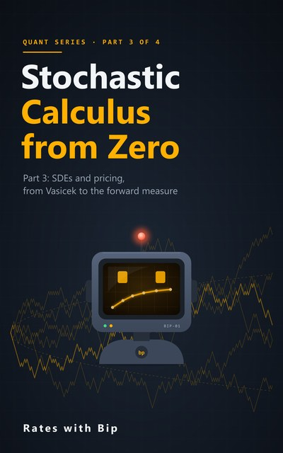
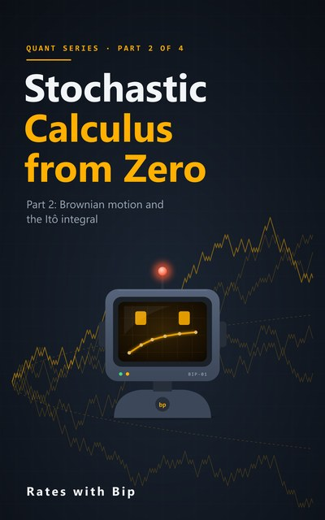

# Stochastic Calculus from Zero



The maths behind the models, from coin tosses to Itô, with Python. It goes a level deeper than
[Options from Zero](../options-from-zero/): where that course uses Itô's lemma, this one shows why it has to be true. School calculus and
the normal distribution are all you need to start.

**Part 1** (Episodes 1-8): why the chain rule breaks on a random path, probability on eight coin worlds, the law of
large numbers, information and filtrations, conditional expectation, martingales, random walks and the Markov property,
and changing the odds (the Radon-Nikodym derivative).
**Part 2** (Episodes 9-16): Brownian motion defined, its strange paths, quadratic variation and why volatility is
measurable but drift isn't, martingales from Brownian motion, the Itô integral and its isometry, the Itô-Doeblin
formula (the chain rule, fixed), and two correlated Brownian motions.
**Part 3** (Episodes 17-25): stochastic differential equations, the Vasicek and CIR short-rate models, simulating SDEs
(Euler and Milstein), Girsanov's theorem, martingale representation and hedging, Feynman-Kac, the reflection principle
and barrier options, and change of numéraire (the forward measure).
Part 4 (interest rates and jumps) follows.

Each episode has a notebook here, ending with five exercises (three by hand, two in code) and their solutions; the
code solutions check themselves. Every number in the videos and the books is computed by these notebooks.

## Part 1: probability, properly

| # | Episode | Notebook | |
|---|---|---|---|
| 1 | **Why Ordinary Calculus Breaks**<br>The squares that don't vanish | [s5e01_why_calculus_breaks.ipynb](notebooks/s5e01_why_calculus_breaks.ipynb) | [](https://colab.research.google.com/github/RatesWithBip/curriculum/blob/main/stochastic-calculus-from-zero/notebooks/s5e01_why_calculus_breaks.ipynb) |
| 2 | **Eight Possible Worlds**<br>Sample space, events and random variables | [s5e02_worlds_and_random_variables.ipynb](notebooks/s5e02_worlds_and_random_variables.ipynb) | [](https://colab.research.google.com/github/RatesWithBip/curriculum/blob/main/stochastic-calculus-from-zero/notebooks/s5e02_worlds_and_random_variables.ipynb) |
| 3 | **Maths Pit Stop: Averages Settle Down**<br>The law of large numbers and one over root n | [s5e03_averages_settle_down.ipynb](notebooks/s5e03_averages_settle_down.ipynb) | [](https://colab.research.google.com/github/RatesWithBip/curriculum/blob/main/stochastic-calculus-from-zero/notebooks/s5e03_averages_settle_down.ipynb) |
| 4 | **Blocks of Information**<br>Filtrations: what you know at time n | [s5e04_filtrations.ipynb](notebooks/s5e04_filtrations.ipynb) | [](https://colab.research.google.com/github/RatesWithBip/curriculum/blob/main/stochastic-calculus-from-zero/notebooks/s5e04_filtrations.ipynb) |
| 5 | **The Best Guess**<br>Conditional expectation | [s5e05_conditional_expectation.ipynb](notebooks/s5e05_conditional_expectation.ipynb) | [](https://colab.research.google.com/github/RatesWithBip/curriculum/blob/main/stochastic-calculus-from-zero/notebooks/s5e05_conditional_expectation.ipynb) |
| 6 | **Martingales: Fair Games**<br>The best guess for tomorrow is today | [s5e06_martingales.ipynb](notebooks/s5e06_martingales.ipynb) | [](https://colab.research.google.com/github/RatesWithBip/curriculum/blob/main/stochastic-calculus-from-zero/notebooks/s5e06_martingales.ipynb) |
| 7 | **Random Walks: Only Now Matters**<br>Independent steps and the Markov property | [s5e07_random_walk_markov.ipynb](notebooks/s5e07_random_walk_markov.ipynb) | [](https://colab.research.google.com/github/RatesWithBip/curriculum/blob/main/stochastic-calculus-from-zero/notebooks/s5e07_random_walk_markov.ipynb) |
| 8 | **Changing the Odds**<br>Same worlds, different weights | [s5e08_changing_the_odds.ipynb](notebooks/s5e08_changing_the_odds.ipynb) | [](https://colab.research.google.com/github/RatesWithBip/curriculum/blob/main/stochastic-calculus-from-zero/notebooks/s5e08_changing_the_odds.ipynb) |

## Part 2: Brownian motion and the Itô integral

| # | Episode | Notebook | |
|---|---|---|---|
| 9 | **Brownian Motion, Defined**<br>Four properties, and why the walk converges | [s5e09_brownian_motion_defined.ipynb](notebooks/s5e09_brownian_motion_defined.ipynb) | [](https://colab.research.google.com/github/RatesWithBip/curriculum/blob/main/stochastic-calculus-from-zero/notebooks/s5e09_brownian_motion_defined.ipynb) |
| 10 | **Brownian Paths Are Strange**<br>Continuous everywhere, smooth nowhere | [s5e10_strange_paths.ipynb](notebooks/s5e10_strange_paths.ipynb) | [](https://colab.research.google.com/github/RatesWithBip/curriculum/blob/main/stochastic-calculus-from-zero/notebooks/s5e10_strange_paths.ipynb) |
| 11 | **Quadratic Variation: What You Can Measure**<br>Volatility yes, drift no | [s5e11_quadratic_variation.ipynb](notebooks/s5e11_quadratic_variation.ipynb) | [](https://colab.research.google.com/github/RatesWithBip/curriculum/blob/main/stochastic-calculus-from-zero/notebooks/s5e11_quadratic_variation.ipynb) |
| 12 | **Martingales from Brownian Motion**<br>W, W² − t and the exponential | [s5e12_brownian_martingales.ipynb](notebooks/s5e12_brownian_martingales.ipynb) | [](https://colab.research.google.com/github/RatesWithBip/curriculum/blob/main/stochastic-calculus-from-zero/notebooks/s5e12_brownian_martingales.ipynb) |
| 13 | **Building the Itô Integral**<br>Left, middle or right? | [s5e13_ito_integral.ipynb](notebooks/s5e13_ito_integral.ipynb) | [](https://colab.research.google.com/github/RatesWithBip/curriculum/blob/main/stochastic-calculus-from-zero/notebooks/s5e13_ito_integral.ipynb) |
| 14 | **No Peeking, No Free Lunch**<br>The Itô isometry and fair trading gains | [s5e14_ito_isometry.ipynb](notebooks/s5e14_ito_isometry.ipynb) | [](https://colab.research.google.com/github/RatesWithBip/curriculum/blob/main/stochastic-calculus-from-zero/notebooks/s5e14_ito_isometry.ipynb) |
| 15 | **The Itô-Doeblin Formula**<br>The chain rule, fixed | [s5e15_ito_doeblin.ipynb](notebooks/s5e15_ito_doeblin.ipynb) | [](https://colab.research.google.com/github/RatesWithBip/curriculum/blob/main/stochastic-calculus-from-zero/notebooks/s5e15_ito_doeblin.ipynb) |
| 16 | **Two Brownian Motions**<br>Correlation, ρ dt and the product rule | [s5e16_two_brownian_motions.ipynb](notebooks/s5e16_two_brownian_motions.ipynb) | [](https://colab.research.google.com/github/RatesWithBip/curriculum/blob/main/stochastic-calculus-from-zero/notebooks/s5e16_two_brownian_motions.ipynb) |

## Part 3: SDEs and pricing

| # | Episode | Notebook | |
|---|---|---|---|
| 17 | **Stochastic Differential Equations**<br>Geometric Brownian motion, solved | [s5e17_sdes_gbm.ipynb](notebooks/s5e17_sdes_gbm.ipynb) | [](https://colab.research.google.com/github/RatesWithBip/curriculum/blob/main/stochastic-calculus-from-zero/notebooks/s5e17_sdes_gbm.ipynb) |
| 18 | **Mean Reversion**<br>Ornstein-Uhlenbeck and Vasicek | [s5e18_mean_reversion.ipynb](notebooks/s5e18_mean_reversion.ipynb) | [](https://colab.research.google.com/github/RatesWithBip/curriculum/blob/main/stochastic-calculus-from-zero/notebooks/s5e18_mean_reversion.ipynb) |
| 19 | **Square-Root Diffusions**<br>CIR, and Feller's condition | [s5e19_cir.ipynb](notebooks/s5e19_cir.ipynb) | [](https://colab.research.google.com/github/RatesWithBip/curriculum/blob/main/stochastic-calculus-from-zero/notebooks/s5e19_cir.ipynb) |
| 20 | **Simulating SDEs**<br>Euler versus Milstein | [s5e20_euler_milstein.ipynb](notebooks/s5e20_euler_milstein.ipynb) | [](https://colab.research.google.com/github/RatesWithBip/curriculum/blob/main/stochastic-calculus-from-zero/notebooks/s5e20_euler_milstein.ipynb) |
| 21 | **Girsanov's Theorem**<br>Change the weights, change the drift | [s5e21_girsanov.ipynb](notebooks/s5e21_girsanov.ipynb) | [](https://colab.research.google.com/github/RatesWithBip/curriculum/blob/main/stochastic-calculus-from-zero/notebooks/s5e21_girsanov.ipynb) |
| 22 | **Martingale Representation**<br>Why a hedge exists | [s5e22_martingale_representation.ipynb](notebooks/s5e22_martingale_representation.ipynb) | [](https://colab.research.google.com/github/RatesWithBip/curriculum/blob/main/stochastic-calculus-from-zero/notebooks/s5e22_martingale_representation.ipynb) |
| 23 | **Feynman-Kac**<br>Expectations are PDEs | [s5e23_feynman_kac.ipynb](notebooks/s5e23_feynman_kac.ipynb) | [](https://colab.research.google.com/github/RatesWithBip/curriculum/blob/main/stochastic-calculus-from-zero/notebooks/s5e23_feynman_kac.ipynb) |
| 24 | **The Reflection Principle**<br>Barrier options | [s5e24_reflection_barriers.ipynb](notebooks/s5e24_reflection_barriers.ipynb) | [](https://colab.research.google.com/github/RatesWithBip/curriculum/blob/main/stochastic-calculus-from-zero/notebooks/s5e24_reflection_barriers.ipynb) |
| 25 | **Change of Numéraire**<br>The forward measure | [s5e25_forward_measure.ipynb](notebooks/s5e25_forward_measure.ipynb) | [](https://colab.research.google.com/github/RatesWithBip/curriculum/blob/main/stochastic-calculus-from-zero/notebooks/s5e25_forward_measure.ipynb) |

## The books

- [**Stochastic Calculus from Zero, Part 1** (PDF, 43 pages)](book/Stochastic-Calculus-from-Zero-Part-1.pdf): one chapter per episode of Part 1, with the definitions and short proofs the videos leave out, all 40 exercises with full answers, the Part 1 checkpoint, a glossary and further reading.
- [**Stochastic Calculus from Zero, Part 2** (PDF, 39 pages)](book/Stochastic-Calculus-from-Zero-Part-2.pdf): one chapter per episode of Part 2, with the proofs: quadratic variation in mean square, the construction of the Itô integral, the isometry, the Itô-Doeblin formula and Lévy's characterisation, all 40 exercises with full answers, the Part 2 checkpoint, a glossary and further reading.
- [**Stochastic Calculus from Zero, Part 3** (PDF, 50 pages)](book/Stochastic-Calculus-from-Zero-Part-3.pdf): one chapter per episode of Part 3, with the proofs: solving SDEs, Feller's condition, the Milstein scheme, Girsanov's theorem, replication, Feynman-Kac, the reflection principle and change of numéraire, all 45 exercises with full answers, the Part 3 checkpoint, a glossary and further reading.

## Run the notebooks

**In Google Colab**, click its **Open in Colab** button above and run the cells in order. Parts 1 and 2 need only
numpy, pandas and matplotlib; Part 3's notebooks start with a cell that installs QuantLib, and Episode 18's with a cell
that writes its data file.

**On your own computer:**

```bash
pip install -r requirements.txt
jupyter lab notebooks/
```

Tested with Python 3.14, pandas 3.0, numpy 2.5 and matplotlib 3.11. Running a notebook writes an `outputs.json` next
to it; git ignores it. Simulations use fixed random seeds, so they repeat exactly.

## Data

- The coin world of Part 1 (a share at 100 that each toss moves up or down 20%, heads with a 60% chance, a deposit
  growing 2% a step), the share of Parts 2 and 3 (volatility 20%, drift 8%, risk-free rate 3.60%), the correlation of 0.5
  and Part 3's short rate (3.85% today, long-run 3.50%, mean reversion 0.30, volatility 1%) are made up for teaching,
  and every path and toss is simulated.
- Episode 18 uses the cash rate target from the Reserve Bank of Australia's Statistical Table F1 (RBA-sourced columns
  only). Source: RBA 2026. The RBA publishes these data free of charge and does not endorse this material.

## Further reading

The notebooks and books are written fresh, but the subject has excellent textbooks, and these make good companions:
Blitzstein and Hwang, *Introduction to Probability* (free online); Shreve, *Stochastic Calculus for Finance I* and *II*;
Neftci, *An Introduction to the Mathematics of Financial Derivatives*; Glasserman, *Monte Carlo Methods in Financial
Engineering*; Brigo and Mercurio, *Interest Rate Models*. None of their examples or exercises are used here.

## Licence

The notebooks are under the [MIT licence](../LICENSE). The books and their covers are under
[CC BY-NC-ND 4.0](../LICENSE-BOOKS.md): share them freely, unchanged, with credit, for non-commercial purposes.
The RBA data in Episode 18 remains subject to the RBA's own terms.

## Support

Everything here is free and stays free. If it helped you, you can buy Bip a coffee:

[](https://ko-fi.com/rateswithbip)

## Disclaimer

For education only. Nothing here is financial, investment, legal or tax advice. Options are risky: a seller can lose
far more than the premium received.
