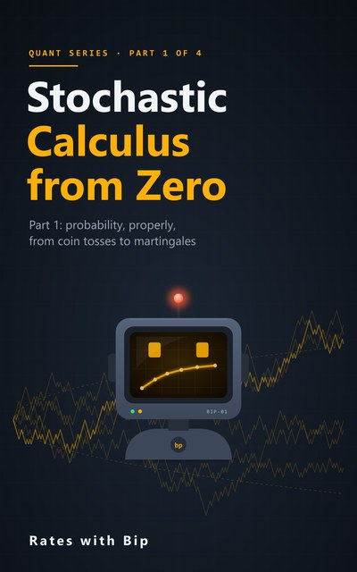

# Stochastic Calculus from Zero



The maths behind the models, from coin tosses to Itô, with Python. It goes a level deeper than
[Options from Zero](../options-from-zero/): where that course uses Itô's lemma, this one shows why it has to be true. School calculus and
the normal distribution are all you need to start.

**Part 1** (Episodes 1-8): why the chain rule breaks on a random path, probability on eight coin worlds, the law of
large numbers, information and filtrations, conditional expectation, martingales, random walks and the Markov property,
and changing the odds (the Radon-Nikodym derivative).
Parts 2-4 (Brownian motion and the Itô integral; SDEs, Girsanov and pricing; interest rates and jumps) follow.

Each episode has a notebook here, ending with five exercises (three by hand, two in code) and their solutions; the
code solutions check themselves. Every number in the videos and the books is computed by these notebooks.

## Part 1: probability, properly

| # | Episode | Notebook | |
|---|---|---|---|
| 1 | **Why Ordinary Calculus Breaks**<br>The squares that don't vanish | [s5e01_why_calculus_breaks.ipynb](notebooks/s5e01_why_calculus_breaks.ipynb) | [](https://colab.research.google.com/github/RatesWithBip/curriculum/blob/main/stochastic-calculus-from-zero/notebooks/s5e01_why_calculus_breaks.ipynb) |
| 2 | **Eight Possible Worlds**<br>Sample space, events and random variables | [s5e02_worlds_and_random_variables.ipynb](notebooks/s5e02_worlds_and_random_variables.ipynb) | [](https://colab.research.google.com/github/RatesWithBip/curriculum/blob/main/stochastic-calculus-from-zero/notebooks/s5e02_worlds_and_random_variables.ipynb) |
| 3 | **Maths Pit Stop: Averages Settle Down**<br>The law of large numbers and one over root n | [s5e03_averages_settle_down.ipynb](notebooks/s5e03_averages_settle_down.ipynb) | [](https://colab.research.google.com/github/RatesWithBip/curriculum/blob/main/stochastic-calculus-from-zero/notebooks/s5e03_averages_settle_down.ipynb) |
| 4 | **Blocks of Information**<br>Filtrations: what you know at time n | [s5e04_filtrations.ipynb](notebooks/s5e04_filtrations.ipynb) | [](https://colab.research.google.com/github/RatesWithBip/curriculum/blob/main/stochastic-calculus-from-zero/notebooks/s5e04_filtrations.ipynb) |
| 5 | **The Best Guess**<br>Conditional expectation | [s5e05_conditional_expectation.ipynb](notebooks/s5e05_conditional_expectation.ipynb) | [](https://colab.research.google.com/github/RatesWithBip/curriculum/blob/main/stochastic-calculus-from-zero/notebooks/s5e05_conditional_expectation.ipynb) |
| 6 | **Martingales: Fair Games**<br>The best guess for tomorrow is today | [s5e06_martingales.ipynb](notebooks/s5e06_martingales.ipynb) | [](https://colab.research.google.com/github/RatesWithBip/curriculum/blob/main/stochastic-calculus-from-zero/notebooks/s5e06_martingales.ipynb) |
| 7 | **Random Walks: Only Now Matters**<br>Independent steps and the Markov property | [s5e07_random_walk_markov.ipynb](notebooks/s5e07_random_walk_markov.ipynb) | [](https://colab.research.google.com/github/RatesWithBip/curriculum/blob/main/stochastic-calculus-from-zero/notebooks/s5e07_random_walk_markov.ipynb) |
| 8 | **Changing the Odds**<br>Same worlds, different weights | [s5e08_changing_the_odds.ipynb](notebooks/s5e08_changing_the_odds.ipynb) | [](https://colab.research.google.com/github/RatesWithBip/curriculum/blob/main/stochastic-calculus-from-zero/notebooks/s5e08_changing_the_odds.ipynb) |

## The books

- [**Stochastic Calculus from Zero, Part 1** (PDF, 43 pages)](book/Stochastic-Calculus-from-Zero-Part-1.pdf): one chapter per episode of Part 1, with the definitions and short proofs the videos leave out, all 40 exercises with full answers, the Part 1 checkpoint, a glossary and further reading.

## Run the notebooks

**In Google Colab**, nothing to install: click its **Open in Colab** button above and run the cells in order. Part 1
needs only numpy, pandas and matplotlib.

**On your own computer:**

```bash
pip install -r requirements.txt
jupyter lab notebooks/
```

Tested with Python 3.14, pandas 3.0, numpy 2.5 and matplotlib 3.11. Running a notebook writes an `outputs.json` next
to it; git ignores it. Simulations use fixed random seeds, so they repeat exactly.

## Data

There is none. The coin world (a share at 100 that each toss moves up or down 20%, heads with a 60% chance, a deposit
growing 2% a step) is made up for teaching, and every path and toss is simulated.

## Further reading

The notebooks and books are written fresh, but the subject has excellent textbooks, and these make good companions:
Blitzstein and Hwang, *Introduction to Probability* (free online); Shreve, *Stochastic Calculus for Finance I* and *II*;
Neftci, *An Introduction to the Mathematics of Financial Derivatives*. None of their examples or exercises are used here.

## Licence

The notebooks are under the [MIT licence](../LICENSE). The books and their covers are under
[CC BY-NC-ND 4.0](../LICENSE-BOOKS.md): share them freely, unchanged, with credit, for non-commercial purposes.

## Support

Everything here is free and stays free. If it helped you, you can buy Bip a coffee:

[](https://ko-fi.com/rateswithbip)

## Disclaimer

For education only. Nothing here is financial, investment, legal or tax advice.
