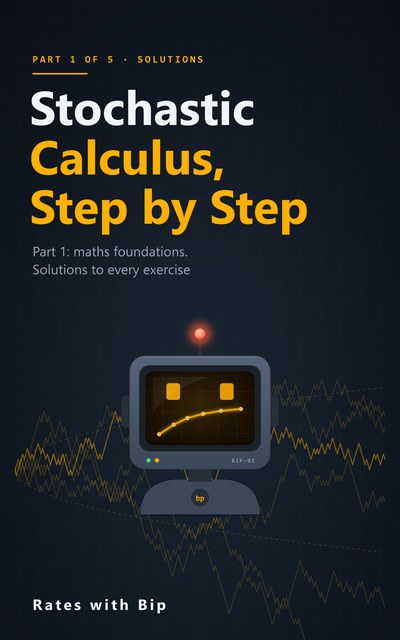

# Stochastic Calculus, Step by Step



From school calculus to the Black-Scholes formula, one careful step at a time, with Python. Written for readers
learning on their own, without a teacher to fill the gaps: every new idea is defined before it is used, explained in
words, tried on a small example, and then derived one line at a time. All you need to start is school algebra.

The course has five parts. **Part 1: Maths Foundations** (Lessons 1-6) is here: the calculus you need (derivatives,
the chain rule, Taylor's theorem, integrals, e and ln), partial derivatives and the two-variable Taylor expansion,
probability (expectation, variance, covariance), the normal distribution and its moment generating function, lognormal
prices and Jensen's inequality, and convergence (Chebyshev and the law of large numbers). Parts 2 to 5 follow: discrete
models and martingales, Brownian motion and Itô calculus, continuous-time pricing and numerical methods, and extensions.

Each lesson has a video, a notebook here and a chapter in the book. Every number in the videos and the books is
computed by these notebooks. Each notebook ends with the lesson's eight exercises (six by hand, two in code); the full
solutions are in a separate book, so you can try them first.

## Part 1: Maths Foundations

| # | Lesson | Notebook | |
|---|---|---|---|
| 1 | **The Calculus You Need**<br>Chain rule, Taylor and logs | [s5e01_calculus_refresher.ipynb](notebooks/s5e01_calculus_refresher.ipynb) | [](https://colab.research.google.com/github/RatesWithBip/curriculum/blob/main/stochastic-calculus-step-by-step/notebooks/s5e01_calculus_refresher.ipynb) |
| 2 | **Multivariable Calculus**<br>Partial derivatives and two-variable Taylor | [s5e02_multivariable_calculus.ipynb](notebooks/s5e02_multivariable_calculus.ipynb) | [](https://colab.research.google.com/github/RatesWithBip/curriculum/blob/main/stochastic-calculus-step-by-step/notebooks/s5e02_multivariable_calculus.ipynb) |
| 3 | **Probability Basics**<br>Expectation, variance and covariance | [s5e03_probability_basics.ipynb](notebooks/s5e03_probability_basics.ipynb) | [](https://colab.research.google.com/github/RatesWithBip/curriculum/blob/main/stochastic-calculus-step-by-step/notebooks/s5e03_probability_basics.ipynb) |
| 4 | **The Normal Distribution**<br>Moments, MGFs and completing the square | [s5e04_normal_distribution.ipynb](notebooks/s5e04_normal_distribution.ipynb) | [](https://colab.research.google.com/github/RatesWithBip/curriculum/blob/main/stochastic-calculus-step-by-step/notebooks/s5e04_normal_distribution.ipynb) |
| 5 | **Lognormal Prices and Jensen's Inequality**<br>Where σ²/2 comes from | [s5e05_lognormal_jensen.ipynb](notebooks/s5e05_lognormal_jensen.ipynb) | [](https://colab.research.google.com/github/RatesWithBip/curriculum/blob/main/stochastic-calculus-step-by-step/notebooks/s5e05_lognormal_jensen.ipynb) |
| 6 | **Convergence**<br>The law of large numbers and Chebyshev's inequality | [s5e06_convergence.ipynb](notebooks/s5e06_convergence.ipynb) | [](https://colab.research.google.com/github/RatesWithBip/curriculum/blob/main/stochastic-calculus-step-by-step/notebooks/s5e06_convergence.ipynb) |

## The books

- [**Part 1: Maths Foundations** (PDF, 82 pages)](book/Stochastic-Calculus-Step-by-Step-Part-1.pdf): one chapter per lesson. Every idea is defined, explained and tried on a small example before it is derived, line by line, with the reason for each step; then worked numbers, what to remember, common mistakes, eight exercises and a self-test. Ends with a formula sheet and a glossary.
- [**Part 1: Solutions** (PDF, 38 pages)](book/Stochastic-Calculus-Step-by-Step-Part-1-Solutions.pdf): every exercise worked in full. Each by-hand solution starts with the one idea that unlocks it, then goes step by step to a check; each code solution is shown with exactly what it prints. Plus the self-test answers.

Try each exercise before you open the solutions.

## Run the notebooks

**In Google Colab**, click a notebook's **Open in Colab** button above and run the cells in order. Part 1 needs only
numpy, pandas and matplotlib, which Colab already has.

**On your own computer:**

```bash
pip install -r requirements.txt
jupyter lab notebooks/
```

Tested with Python 3.14, numpy 2.5, pandas 3.0 and matplotlib 3.11. Running a notebook writes `build/outputs.json`
next to it; git ignores it. Simulations use a fixed random seed (2026), so they repeat exactly.

## Data

The whole course uses one made-up example: a share at 100, a strike of 105, a risk-free rate of 3% (continuously
compounded), a volatility of 20% and a horizon of one year. Every path is simulated. There is no market data.

## Further reading

The notebooks and books are written fresh, but these make good companions: any first-year calculus text for Lessons 1
and 2; Blitzstein and Hwang, *Introduction to Probability* (free online); Mikosch, *Elementary Stochastic Calculus with
Finance in View*, Chapter 1; and, for what comes next, Shreve, *Stochastic Calculus for Finance I*. None of their
examples or exercises are used here.

## Licence

The notebooks are under the [MIT licence](../LICENSE). The books and their covers are under
[CC BY-NC-ND 4.0](../LICENSE-BOOKS.md): share them freely, unchanged, with credit, for non-commercial purposes.

## Support

Everything here is free and stays free. If it helped you, you can buy Bip a coffee:

[](https://ko-fi.com/rateswithbip)

## Disclaimer

For education only. Nothing here is financial, investment, legal or tax advice.
