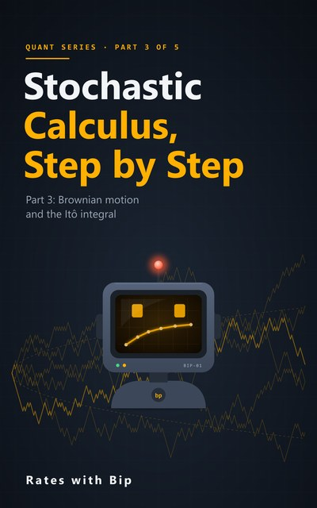
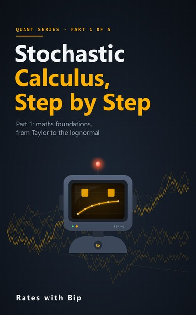

# Stochastic Calculus, Step by Step



From school calculus to the Black-Scholes formula, one careful step at a time, with Python. Written for readers
learning on their own, without a teacher to fill the gaps: every new idea is defined before it is used, explained in
words, tried on a small example, and then derived one line at a time. All you need to start is school algebra.

The course has five parts, and the first three are here:

- **Part 1: Maths Foundations** (Lessons 1-6): the calculus you need (derivatives, the chain rule, Taylor's theorem,
  integrals, e and ln), partial derivatives and the two-variable Taylor expansion, probability (expectation, variance,
  covariance), the normal distribution and its moment generating function, lognormal prices and Jensen's inequality,
  and convergence (Chebyshev and the law of large numbers).
- **Part 2: Discrete Models** (Lessons 7-12): information as σ-algebras, conditional expectation, copying an option on
  a binomial tree, backward induction and hedging, martingales and the fundamental theorems of asset pricing, change of
  measure and American options.
- **Part 3: Brownian Motion and the Itô Integral** (Lessons 13-18): Brownian motion from a random walk, quadratic
  variation, the Itô integral, Itô's lemma, geometric Brownian motion and Euler's method, and the tools for spotting
  martingales.

Parts 4 and 5 follow: continuous-time pricing and numerical methods, and extensions.

Each lesson has a video, a notebook here and a chapter in the book. Every number in the videos and the books is
computed by these notebooks. Each notebook ends with the lesson's eight exercises (six by hand, two in code); the full
solutions are in a separate book for each part, so you can try them first.

## Part 1: Maths Foundations

| # | Lesson | Notebook | |
|---|---|---|---|
| 1 | **The Calculus You Need**<br>Chain rule, Taylor and logs | [s5e01_calculus_refresher.ipynb](notebooks/s5e01_calculus_refresher.ipynb) | [](https://colab.research.google.com/github/RatesWithBip/curriculum/blob/main/stochastic-calculus-step-by-step/notebooks/s5e01_calculus_refresher.ipynb) |
| 2 | **Multivariable Calculus**<br>Partial derivatives and two-variable Taylor | [s5e02_multivariable_calculus.ipynb](notebooks/s5e02_multivariable_calculus.ipynb) | [](https://colab.research.google.com/github/RatesWithBip/curriculum/blob/main/stochastic-calculus-step-by-step/notebooks/s5e02_multivariable_calculus.ipynb) |
| 3 | **Probability Basics**<br>Expectation, variance and covariance | [s5e03_probability_basics.ipynb](notebooks/s5e03_probability_basics.ipynb) | [](https://colab.research.google.com/github/RatesWithBip/curriculum/blob/main/stochastic-calculus-step-by-step/notebooks/s5e03_probability_basics.ipynb) |
| 4 | **The Normal Distribution**<br>Moments, MGFs and completing the square | [s5e04_normal_distribution.ipynb](notebooks/s5e04_normal_distribution.ipynb) | [](https://colab.research.google.com/github/RatesWithBip/curriculum/blob/main/stochastic-calculus-step-by-step/notebooks/s5e04_normal_distribution.ipynb) |
| 5 | **Lognormal Prices and Jensen's Inequality**<br>Where σ²/2 comes from | [s5e05_lognormal_jensen.ipynb](notebooks/s5e05_lognormal_jensen.ipynb) | [](https://colab.research.google.com/github/RatesWithBip/curriculum/blob/main/stochastic-calculus-step-by-step/notebooks/s5e05_lognormal_jensen.ipynb) |
| 6 | **Convergence**<br>The law of large numbers and Chebyshev's inequality | [s5e06_convergence.ipynb](notebooks/s5e06_convergence.ipynb) | [](https://colab.research.google.com/github/RatesWithBip/curriculum/blob/main/stochastic-calculus-step-by-step/notebooks/s5e06_convergence.ipynb) |

## Part 2: Discrete Models

| # | Lesson | Notebook | |
|---|---|---|---|
| 7 | **Information and Measure**<br>What you know, and when | [s5e07_information_and_measure.ipynb](notebooks/s5e07_information_and_measure.ipynb) | [](https://colab.research.google.com/github/RatesWithBip/curriculum/blob/main/stochastic-calculus-step-by-step/notebooks/s5e07_information_and_measure.ipynb) |
| 8 | **Conditional Expectation**<br>The best guess with what you know | [s5e08_conditional_expectation.ipynb](notebooks/s5e08_conditional_expectation.ipynb) | [](https://colab.research.google.com/github/RatesWithBip/curriculum/blob/main/stochastic-calculus-step-by-step/notebooks/s5e08_conditional_expectation.ipynb) |
| 9 | **The One-Period Binomial Model**<br>Copying a call, and where p̃ comes from | [s5e09_one_period_binomial.ipynb](notebooks/s5e09_one_period_binomial.ipynb) | [](https://colab.research.google.com/github/RatesWithBip/curriculum/blob/main/stochastic-calculus-step-by-step/notebooks/s5e09_one_period_binomial.ipynb) |
| 10 | **The Multi-Period Binomial Model**<br>Backward induction, hedging and parity | [s5e10_multi_period_binomial.ipynb](notebooks/s5e10_multi_period_binomial.ipynb) | [](https://colab.research.google.com/github/RatesWithBip/curriculum/blob/main/stochastic-calculus-step-by-step/notebooks/s5e10_multi_period_binomial.ipynb) |
| 11 | **Martingales and Risk-Neutral Pricing**<br>Fair games, the pricing formula and FTAP | [s5e11_martingales.ipynb](notebooks/s5e11_martingales.ipynb) | [](https://colab.research.google.com/github/RatesWithBip/curriculum/blob/main/stochastic-calculus-step-by-step/notebooks/s5e11_martingales.ipynb) |
| 12 | **Change of Measure and American Options**<br>Radon-Nikodym, state prices and early exercise | [s5e12_change_of_measure_american.ipynb](notebooks/s5e12_change_of_measure_american.ipynb) | [](https://colab.research.google.com/github/RatesWithBip/curriculum/blob/main/stochastic-calculus-step-by-step/notebooks/s5e12_change_of_measure_american.ipynb) |

## Part 3: Brownian Motion and the Itô Integral

| # | Lesson | Notebook | |
|---|---|---|---|
| 13 | **Brownian Motion**<br>From a random walk to a random path | [s5e13_brownian_motion.ipynb](notebooks/s5e13_brownian_motion.ipynb) | [](https://colab.research.google.com/github/RatesWithBip/curriculum/blob/main/stochastic-calculus-step-by-step/notebooks/s5e13_brownian_motion.ipynb) |
| 14 | **The Strange Properties of Brownian Paths**<br>No slope, infinite length, quadratic variation T | [s5e14_brownian_paths.ipynb](notebooks/s5e14_brownian_paths.ipynb) | [](https://colab.research.google.com/github/RatesWithBip/curriculum/blob/main/stochastic-calculus-step-by-step/notebooks/s5e14_brownian_paths.ipynb) |
| 15 | **The Itô Integral**<br>Why left endpoints, and three properties | [s5e15_ito_integral.ipynb](notebooks/s5e15_ito_integral.ipynb) | [](https://colab.research.google.com/github/RatesWithBip/curriculum/blob/main/stochastic-calculus-step-by-step/notebooks/s5e15_ito_integral.ipynb) |
| 16 | **Itô's Lemma**<br>The chain rule for random paths | [s5e16_itos_lemma.ipynb](notebooks/s5e16_itos_lemma.ipynb) | [](https://colab.research.google.com/github/RatesWithBip/curriculum/blob/main/stochastic-calculus-step-by-step/notebooks/s5e16_itos_lemma.ipynb) |
| 17 | **Geometric Brownian Motion**<br>Solving the share's equation | [s5e17_geometric_brownian_motion.ipynb](notebooks/s5e17_geometric_brownian_motion.ipynb) | [](https://colab.research.google.com/github/RatesWithBip/curriculum/blob/main/stochastic-calculus-step-by-step/notebooks/s5e17_geometric_brownian_motion.ipynb) |
| 18 | **The Itô Toolbox**<br>Martingale tests, exponentials and the product rule | [s5e18_ito_toolbox.ipynb](notebooks/s5e18_ito_toolbox.ipynb) | [](https://colab.research.google.com/github/RatesWithBip/curriculum/blob/main/stochastic-calculus-step-by-step/notebooks/s5e18_ito_toolbox.ipynb) |

## The books

- [**Part 1: Maths Foundations** (PDF, 82 pages)](book/Stochastic-Calculus-Step-by-Step-Part-1.pdf): one chapter per lesson. Every idea is defined, explained and tried on a small example before it is derived, line by line, with the reason for each step; then worked numbers, what to remember, common mistakes, eight exercises and a self-test. Ends with a formula sheet and a glossary.
- [**Part 1: Solutions** (PDF, 38 pages)](book/Stochastic-Calculus-Step-by-Step-Part-1-Solutions.pdf): every exercise worked in full. Each by-hand solution starts with the one idea that unlocks it, then goes step by step to a check; each code solution is shown with exactly what it prints. Plus the self-test answers.
- [**Part 2: Discrete Models** (PDF, 74 pages)](book/Stochastic-Calculus-Step-by-Step-Part-2.pdf): option pricing on a coin-toss tree small enough to check by hand: information and conditional expectation, copying an option, backward induction and hedging, martingales and the fundamental theorems, change of measure and American options. Same layout as Part 1.
- [**Part 2: Solutions** (PDF, 38 pages)](book/Stochastic-Calculus-Step-by-Step-Part-2-Solutions.pdf): every Part 2 exercise and self-test question, worked in full in the same way.
- [**Part 3: Brownian Motion and the Itô Integral** (PDF, 57 pages)](book/Stochastic-Calculus-Step-by-Step-Part-3.pdf): the steps shrink to nothing: Brownian motion, quadratic variation, the Itô integral, Itô's lemma, geometric Brownian motion and Euler's method, and the tools for spotting martingales. Same layout as Part 1.
- [**Part 3: Solutions** (PDF, 29 pages)](book/Stochastic-Calculus-Step-by-Step-Part-3-Solutions.pdf): every Part 3 exercise and self-test question, worked in full in the same way.

Try each exercise before you open the solutions.

## Run the notebooks

**In Google Colab**, click a notebook's **Open in Colab** button above and run the cells in order. The notebooks need
only numpy, pandas and matplotlib, which Colab already has.

**On your own computer:**

```bash
pip install -r requirements.txt
jupyter lab notebooks/
```

Tested with Python 3.14, numpy 2.5, pandas 3.0 and matplotlib 3.11. Running a notebook writes `build/outputs.json`
next to it; git ignores it. Simulations use a fixed random seed (2026), so they repeat exactly.

## Data

The whole course uses one made-up example: a share at 100, a strike of 105, a risk-free rate of 3% (continuously
compounded), a volatility of 20% and a horizon of one year. Part 2 adds a small teaching tree on those numbers: the share
moves up or down 10% every four months, with a made-up real-world chance of 0.6 of going up. Every path is simulated.
There is no market data.

## Further reading

The notebooks and books are written fresh, but these make good companions: any first-year calculus text for Lessons 1
and 2; Blitzstein and Hwang, *Introduction to Probability* (free online); Shreve, *Stochastic Calculus for Finance I*,
Chapters 1 to 4, for Part 2; Baxter and Rennie, *Financial Calculus*, Chapter 2; Shreve, *Stochastic Calculus for
Finance II*, Chapters 3 and 4, for Part 3; and Mikosch, *Elementary Stochastic Calculus with Finance in View*, for
Parts 1 and 3. None of their examples or exercises are used here.

## Licence

The notebooks are under the [MIT licence](../LICENSE). The books and their covers are under
[CC BY-NC-ND 4.0](../LICENSE-BOOKS.md): share them freely, unchanged, with credit, for non-commercial purposes.

## Support

Everything here is free and stays free. If it helped you, you can buy Bip a coffee:

[](https://ko-fi.com/rateswithbip)

## Disclaimer

For education only. Nothing here is financial, investment, legal or tax advice.
