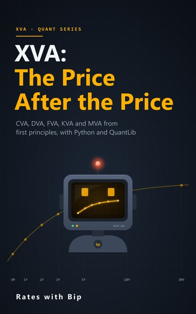

# XVA: The Price After the Price



Valuation adjustments from first principles: CVA, DVA, FVA, ColVA, KVA and MVA, with Python and QuantLib.
15 episodes following one five-year AUD swap with a fictional BBB company, a notebook for each, and a book:
default probabilities from CDS, Hull-White simulation, exposure and why it is a
swaption, CVA three ways, netting and allocation, DVA, collateral and the margin period of risk, funding, Basel capital
(SA-CCR and BA-CVA), initial margin, wrong-way risk, the full bill for an AUD/USD cross-currency swap, and how banks
compute it all at scale. It builds on [AUD Swaps & Curves](../aud-swaps-and-curves/), [SOFR, FX & Cross-Currency Curves](../sofr-fx-and-cross-currency-curves/) and
[Options from Zero](../options-from-zero/).

Every number in the videos and the book is computed by these notebooks.

## Episodes

| # | Episode | Notebook | |
|---|---|---|---|
| 1 | **The Price After the Price: What XVA Is**<br>Why two banks quote you different rates for the same swap | [s4e01_the_price_after_the_price.ipynb](notebooks/s4e01_the_price_after_the_price.ipynb) | [](https://colab.research.google.com/github/RatesWithBip/curriculum/blob/main/xva-the-price-after-the-price/notebooks/s4e01_the_price_after_the_price.ipynb) |
| 2 | **Default Odds from CDS Spreads**<br>Hazard rates, survival curves and the credit triangle | [s4e02_default_odds.ipynb](notebooks/s4e02_default_odds.ipynb) | [](https://colab.research.google.com/github/RatesWithBip/curriculum/blob/main/xva-the-price-after-the-price/notebooks/s4e02_default_odds.ipynb) |
| 3 | **Simulating Tomorrow's Curve: Hull-White**<br>A model that fits today's curve and prices swaptions | [s4e03_hull_white.ipynb](notebooks/s4e03_hull_white.ipynb) | [](https://colab.research.google.com/github/RatesWithBip/curriculum/blob/main/xva-the-price-after-the-price/notebooks/s4e03_hull_white.ipynb) |
| 4 | **Exposure: EE and PFE**<br>What a counterparty could owe you, and when | [s4e04_exposure.ipynb](notebooks/s4e04_exposure.ipynb) | [](https://colab.research.google.com/github/RatesWithBip/curriculum/blob/main/xva-the-price-after-the-price/notebooks/s4e04_exposure.ipynb) |
| 5 | **Expected Exposure Is a Swaption**<br>Pricing exposure without a simulation | [s4e05_exposure_swaption.ipynb](notebooks/s4e05_exposure_swaption.ipynb) | [](https://colab.research.google.com/github/RatesWithBip/curriculum/blob/main/xva-the-price-after-the-price/notebooks/s4e05_exposure_swaption.ipynb) |
| 6 | **CVA: Pricing the Option to Default**<br>An exposure profile times a default curve | [s4e06_cva.ipynb](notebooks/s4e06_cva.ipynb) | [](https://colab.research.google.com/github/RatesWithBip/curriculum/blob/main/xva-the-price-after-the-price/notebooks/s4e06_cva.ipynb) |
| 7 | **Netting, and Who Pays for the CVA**<br>Exposure doesn't add up, so neither does CVA | [s4e07_netting.ipynb](notebooks/s4e07_netting.ipynb) | [](https://colab.research.google.com/github/RatesWithBip/curriculum/blob/main/xva-the-price-after-the-price/notebooks/s4e07_netting.ipynb) |
| 8 | **DVA: Profiting from Your Own Decline**<br>Bilateral CVA, symmetry and the own-credit paradox | [s4e08_dva.ipynb](notebooks/s4e08_dva.ipynb) | [](https://colab.research.google.com/github/RatesWithBip/curriculum/blob/main/xva-the-price-after-the-price/notebooks/s4e08_dva.ipynb) |
| 9 | **Collateral and the Margin Period of Risk**<br>Why daily margin doesn't take exposure to zero | [s4e09_collateral.ipynb](notebooks/s4e09_collateral.ipynb) | [](https://colab.research.google.com/github/RatesWithBip/curriculum/blob/main/xva-the-price-after-the-price/notebooks/s4e09_collateral.ipynb) |
| 10 | **FVA and the Funding Debate**<br>Who pays for the cash a hedge ties up | [s4e10_fva.ipynb](notebooks/s4e10_fva.ipynb) | [](https://colab.research.google.com/github/RatesWithBip/curriculum/blob/main/xva-the-price-after-the-price/notebooks/s4e10_fva.ipynb) |
| 11 | **Capital and KVA**<br>The biggest line on the bill | [s4e11_capital_kva.ipynb](notebooks/s4e11_capital_kva.ipynb) | [](https://colab.research.google.com/github/RatesWithBip/curriculum/blob/main/xva-the-price-after-the-price/notebooks/s4e11_capital_kva.ipynb) |
| 12 | **Initial Margin and MVA**<br>Collateral for the close-out gap, and what it costs | [s4e12_initial_margin.ipynb](notebooks/s4e12_initial_margin.ipynb) | [](https://colab.research.google.com/github/RatesWithBip/curriculum/blob/main/xva-the-price-after-the-price/notebooks/s4e12_initial_margin.ipynb) |
| 13 | **Wrong-Way Risk**<br>When default and exposure move together | [s4e13_wrong_way_risk.ipynb](notebooks/s4e13_wrong_way_risk.ipynb) | [](https://colab.research.google.com/github/RatesWithBip/curriculum/blob/main/xva-the-price-after-the-price/notebooks/s4e13_wrong_way_risk.ipynb) |
| 14 | **Series Finale: XVA of a Cross-Currency Swap**<br>The whole bill, and why the market resets its notionals | [s4e14_capstone_xccy.ipynb](notebooks/s4e14_capstone_xccy.ipynb) | [](https://colab.research.google.com/github/RatesWithBip/curriculum/blob/main/xva-the-price-after-the-price/notebooks/s4e14_capstone_xccy.ipynb) |
| 15 | **Bonus: How Banks Compute XVA**<br>Millions of trades, thousands of paths, one night | [s4e15_how_banks_compute.ipynb](notebooks/s4e15_how_banks_compute.ipynb) | [](https://colab.research.google.com/github/RatesWithBip/curriculum/blob/main/xva-the-price-after-the-price/notebooks/s4e15_how_banks_compute.ipynb) |

## The book

[**XVA: The Price After the Price** (PDF, 63 pages)](book/XVA-The-Price-After-the-Price.pdf): one chapter per episode, with the derivations, the checks
against QuantLib and against simulation, and the sources for every regulatory parameter.

## Run the notebooks

**In Google Colab**, nothing to install: click its **Open in Colab** button above. The first cells install
QuantLib 1.43 and write the data the notebook reads. Then run the cells in order. Each notebook simulates 40,000
paths; most run in under a minute.

**On your own computer:**

```bash
pip install -r requirements.txt
jupyter lab notebooks/
```

Tested with Python 3.14, QuantLib 1.43, pandas 3.0, numpy 2.5 and matplotlib 3.11. Running a notebook writes its data
files and an `outputs.json` next to it; git ignores them.

## Data

- All market inputs are illustrative, made up for teaching: the AONIA and BBSW curves of AUD Swaps & Curves, the SOFR
  and AUD/USD market of SOFR, FX & Cross-Currency Curves, and the CDS spreads, swaption volatilities, AUD/USD volatility, funding spread and
  cost of capital. They are not market data.
- Counterparty A, Counterparty W, the AA and BB clients and Our bank are fictional.
- Regulatory parameters (SA-CCR, standardised risk weights, the reduced BA-CVA, the standard initial margin schedule)
  follow the Basel Framework as in force in 2026, simplified for teaching. Rules change: consult the current Basel
  standards and APRA's prudential standards before relying on them.

## Licence

The notebooks are under the [MIT licence](../LICENSE). The book and its cover are under
[CC BY-NC-ND 4.0](../LICENSE-BOOKS.md): share them freely, unchanged, with credit, for non-commercial purposes.

## Support

Everything here is free and stays free. If it helped you, you can buy Bip a coffee:

[](https://ko-fi.com/rateswithbip)

## Disclaimer

For education only. Nothing here is financial, investment, accounting, legal, regulatory or tax advice.
